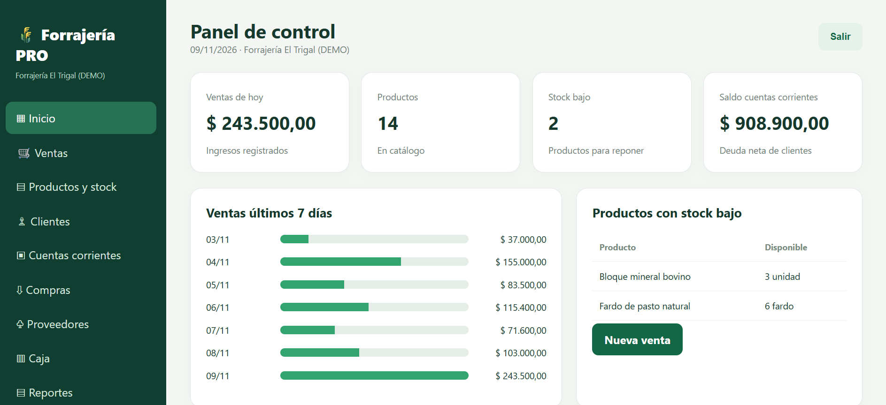

# Forrajería PRO — ejemplo técnico

Demostración independiente en **PHP 8.1+ y SQLite**, con productos ficticios. No contiene código de producción ni datos de clientes.

## Ejecución

Desde `ejemplo-php`, ejecutar `php demo.php` con la extensión `pdo_sqlite` habilitada.

Incluye búsqueda de productos, alta de productos y venta con descuento de stock mediante transacción y consultas preparadas. El ejemplo usa SQLite en memoria; no crea archivos de base de datos.

Este código es una muestra educativa, no un sistema comercial completo.
## Captura del sistema

